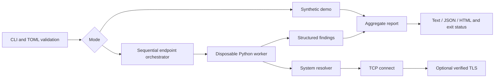

# Project specification and implementation plan

Owner: devmeto5. Version: 0.1.0. Language: English.

## Objective

Provide a repeatable connectivity triage tool complementary to DC HealthCheck Pro. Technicians can separate resolver, transport, and TLS failures; administrators can check endpoint reachability and certificate renewal needs. The output proposes next steps without making infrastructure changes.

## Requirements and acceptance

| ID | Requirement | Acceptance |
|---|---|---|
| N-01 | Explicit targets only | CLI requires demo or configuration; no discovery |
| N-02 | Strict TOML configuration | Reject URLs, wildcards, CIDRs, duplicate endpoints, invalid ports and unknown keys |
| N-03 | Resolver evidence | Successful resolution differs from failure; dependencies skip on failure |
| N-04 | TCP connection check | Real loopback listener succeeds; refusal becomes critical |
| N-05 | Verified TLS and expiry | Trusted local certificate succeeds; untrusted certificate fails; expiry boundaries are tested |
| N-06 | Per-endpoint deadline | Parent terminates timed-out worker; subsequent endpoints continue |
| N-07 | Portable reports | Parseable JSON, escaped HTML, readable terminal output, explicit LIVE/DEMO mode |
| N-08 | Safe output creation | Existing files are preserved |
| N-09 | Reproducible verification | Local tests plus Python 3.11–3.13 Linux/Windows CI |

Configuration: timeout 1–30 seconds; warning_days 1–365; optional CA bundle; 1–32 targets with host, integer port 1–65535, and Boolean tls. Config input is bounded to 64 KiB. ASCII DNS names and unscoped IP literals are supported; IDNs must be supplied in ASCII punycode.

Status rules: DNS resolution failure, inability to connect, or failed TLS verification are CRITICAL. A verified certificate with <= warning_days remaining is WARNING. Missing evidence or local worker failure is UNKNOWN. A known critical dominates unknown in aggregate reporting. Zero or negative certificate lifetime is critical in evaluation; an expired real certificate is normally rejected earlier during TLS verification.

## Architecture

`config.py` validates input; `runner.py` owns subprocess lifetime; `worker.py` runs one endpoint; `probes.py` handles sockets and TLS; `reporting.py` owns the schema and renderers; `cli.py` connects these components. All runtime dependencies are from the standard library.

A subprocess is used instead of a thread because system name resolution may block beyond a socket timeout. The parent uses subprocess.run's timeout behavior to kill and wait for a stalled child. On timeout all evidence for that target becomes UNKNOWN. Probes use socket operations only, no shell commands. DNS answers are trusted as the operator's configured resolver view, not as security attestation.

JSON schema 1.0 contains schema_version, tool_version, timestamp (UTC ISO-8601), mode, overall status, and endpoints. Each endpoint contains host, port, and checks. Each check includes check identifier, status, evidence, and next_step. Evidence is descriptive text; future numeric metric fields require a documented compatible extension or schema change.

## Implementation stages

1. Specify explicit targeting, results, deadline behavior, and release criteria.
2. Implement validation, DNS/TCP/TLS probes, worker isolation, reports, and portable demo.
3. Verify formulas, input handling, failure paths, and real local TCP/TLS connections.
4. Publish English documentation and synthetic examples; inspect all CI matrix jobs.
5. Future: expected DNS-address comparison, repeated measurements and baseline comparison, optional client certificates. Each requires dedicated tests and explicit scope. Fleet scanning and remediation are not planned for v0.1.0.

Release criteria: all tests and installation checks pass, all six CI jobs succeed, no real infrastructure reports are published, and limitations are documented. Physical data-center or production validation must be recorded independently; loopback testing does not establish either.

## References

TLS context and hostname verification follow the [Python SSL documentation](https://docs.python.org/3.11/library/ssl.html). Resolution and TCP use the [Python socket APIs](https://docs.python.org/3.11/library/socket.html). Certificate revocation and full TLS security auditing are deliberately outside the initial scope.
